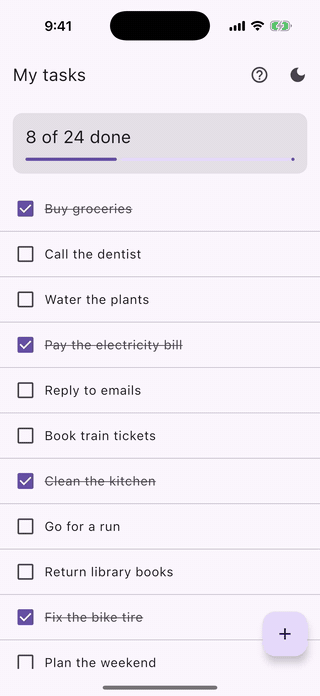

# Compose Tour

A Compose Multiplatform overlay that walks users through a screen, one element at a time. It dims
the screen, cuts out the current element, and shows a tip next to it. Moving to the next step glides
the cutout and the tip to the new element.



Targets: Android, iOS, desktop (JVM).

## Installation

Not on Maven Central yet. Once it is released, add it to your shared module's `commonMain`:

```kotlin
kotlin {
    sourceSets {
        commonMain.dependencies {
            implementation("io.github.tikarm:compose-tour:0.1.0")
        }
    }
}
```

To try it before the release, run `./gradlew :tour:publishToMavenLocal` in this repository, add
`mavenLocal()` to your project's repositories, and use version `0.1.0-SNAPSHOT`.

## Usage

```kotlin
enum class Step { Header, Add }

val targets = rememberTourTargets<Step>()
var step by remember { mutableStateOf<Step?>(Step.Header) }

TourHost(
    target = step,
    targets = targets,
    tip = { shown ->
        TourCard(
            step = shown.ordinal,
            stepCount = Step.entries.size,
            onNext = { step = Step.entries.getOrNull(shown.ordinal + 1) },
            onPrevious = { step = Step.entries.getOrNull(shown.ordinal - 1) },
            onSkip = { step = null },
        ) { index ->
            TourCardText(title = "Step ${index + 1}", message = "**Add** creates a new task.")
        }
    },
) {
    // Your screen, unchanged
    Column {
        Header(Modifier.tourTarget(Step.Header, targets))
        AddButton(Modifier.tourTarget(Step.Add, targets))
    }
}
```

- `TourHost` shows your screen with the tour overlay on top. Wrap the whole screen in it, usually
  at the root, so the overlay covers everything.
- Mark each element with `Modifier.tourTarget(key, targets)`. The key can be any type; an enum of
  steps works well.
- `step = null` hides the overlay.
- The tip can be any composable; `TourCard` is an optional ready-made one with step dots, swipe
  between steps, and Skip and Next buttons. Its colors and the overlay's scrim come from the
  current `MaterialTheme`, so they follow your app's theme, light or dark. Change any of them with
  `TourCardDefaults.colors(nextBackground = ...)`, and the button texts with `labels`.
- In `TourCardText`, text wrapped in `**` is shown in bold.
- The overlay blocks all touches underneath, including on the highlighted element, so tips should
  not ask users to tap it.
- Pass `onDismissRequest = { step = null }` to end the tour on the system back action (Esc on
  desktop). Without it, back handling is up to the app.
- While the tour is shown, `TourHost` keeps screen readers and keyboard focus on the tip, the same
  way the overlay keeps touches there. `TourCard` has an optional Back button
  (`showPreviousButton = true`), and screen readers get a Back action on it either way.

### Dialogs and bottom sheets

A dialog or bottom sheet opens in its own window. Elements inside it need their own `TourTargets`
and their own `TourHost` (or `TourOverlay`) inside that window.

### Placing the overlay yourself

`TourHost` is a `Box` with your content first and a `TourOverlay` last. If you need the overlay
somewhere else, use `TourOverlay` directly. Put it last in a `Box` that fills the window, so it
draws on top of everything else.

## Sample

A small to-do list (`sample/shared`) with a five-step tour: a progress card, a task the list
scrolls to, a button at the bottom edge, a top bar icon, and a step with no target. The icons in the top bar
restart the tour and switch between light and dark.

- Desktop: `./gradlew :sample:shared:run`
- Android: `./gradlew :sample:android:installDebug`, or run `sample.android` from Android Studio
- iOS: open `sample/ios/TourSample.xcodeproj` in Xcode and run. The first build compiles the Kotlin
  framework and takes a few minutes.

## Publishing

The `tour` module uses [gradle-maven-publish-plugin](https://github.com/vanniktech/gradle-maven-publish-plugin).
`./gradlew publishToMavenLocal` works without setup. Releasing to Maven Central needs a Central
Portal account and signing keys in `~/.gradle/gradle.properties`.

## License

Apache License 2.0. See [LICENSE](LICENSE).
